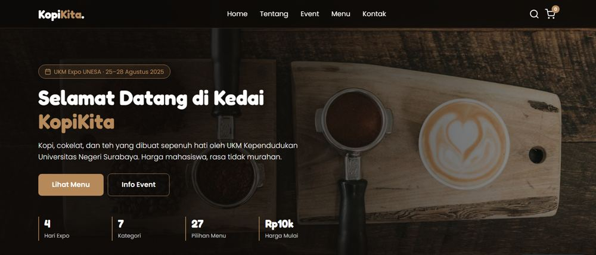
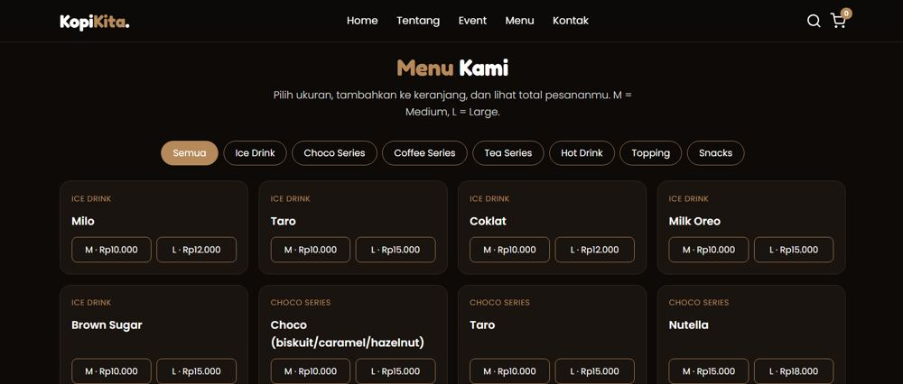
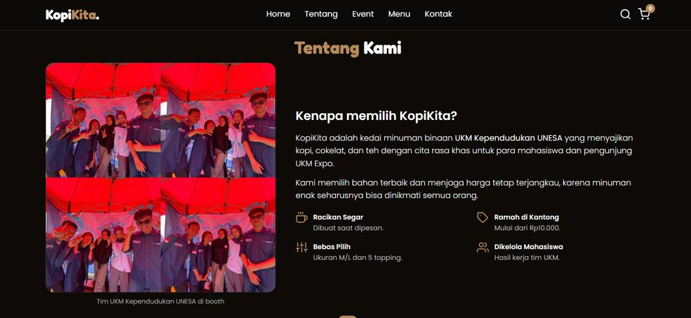
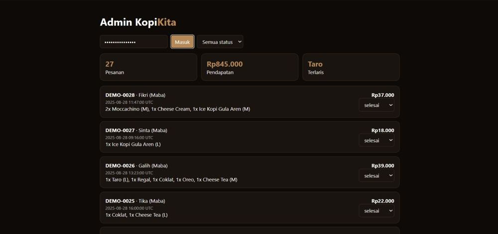

# KopiKita

Website dan sistem pemesanan untuk kedai **KopiKita** milik UKM Kependudukan UNESA, dibuat untuk UKM Expo UNESA 25-28 Agustus 2025.
Pelanggan memilih menu dan ukuran, pesanan disimpan di database, lalu pesan WhatsApp terisi otomatis. Admin mengelola pesanan lewat dashboard.

*English: a full-stack coffee-shop ordering system (vanilla JS frontend, Node.js REST API without dependencies, SQLite) with an admin dashboard and 9 automated API tests.*

| Beranda | Menu |
|---|---|
|  |  |

| Tentang | Dashboard admin (data demo) |
|---|---|
|  |  |

## Fitur

- **Menu interaktif:** 27 item dalam 7 kategori, filter kategori, pencarian, pilihan ukuran M/L, keranjang dengan total otomatis.
- **Pemesanan:** pesanan disimpan ke database dengan kode `KK-XXXXXX`, lalu diteruskan sebagai pesan WhatsApp terformat (`wa.me`).
- **Dashboard admin** (`/admin.html`): jumlah pesanan, pendapatan, menu terlaris, filter dan ubah status pesanan, atur ketersediaan menu.
- **Keamanan dasar:** harga dihitung ulang di server, validasi input, rate limiting, token admin, prepared statements, proteksi path traversal.

## Teknologi

| Bagian | Yang dipakai |
|---|---|
| Frontend | HTML5, CSS3, JavaScript murni, Feather Icons, font Fredoka dan Poppins |
| Backend | Node.js (modul `http` bawaan, tanpa dependency) |
| Database | SQLite lewat `node:sqlite` |
| Pengujian | `node:test` bawaan Node.js |

## Menjalankan

Butuh **Node.js >= 22.13**.

```bash
cd KopiKita
ADMIN_TOKEN=ganti-token-rahasia npm start
# situs   : http://localhost:3000
# admin   : http://localhost:3000/admin.html
```

Di Windows PowerShell:

```powershell
cd KopiKita
$env:ADMIN_TOKEN="ganti-token-rahasia"; npm start
```

| Variabel | Fungsi |
|---|---|
| `PORT` | Port server (default `3000`) |
| `ADMIN_TOKEN` | Token login dashboard admin. **Wajib diganti** di lingkungan nyata |
| `DB_PATH` | Lokasi file database SQLite |

Data contoh untuk dashboard (semua berkode `DEMO-xxxx`, nama fiktif):

```bash
node seed-demo.js           # tambah data contoh
node seed-demo.js --reset   # hapus data contoh saja
```

Jalankan server sekali (`npm start`) sebelum seed supaya tabel menu terisi.

## API

| Method | Endpoint | Keterangan |
|---|---|---|
| GET | `/api/menu` | Daftar menu yang tersedia |
| POST | `/api/orders` | Buat pesanan `{buyer, items:[{id, size, qty}]}`, harga dihitung ulang di server |
| GET | `/api/admin/orders` | Daftar pesanan (butuh Bearer token) |
| GET | `/api/admin/stats` | Statistik pesanan, pendapatan, menu terlaris |
| GET | `/api/admin/menu` | Daftar menu untuk admin |
| PATCH | `/api/admin/orders/:id` | Ubah status: `baru`, `diproses`, `selesai`, `batal` |
| PATCH | `/api/admin/menu/:id` | Ubah ketersediaan menu |

Tabel database: `menu`, `orders`, `order_items` (dengan foreign key). Pembuatan pesanan memakai transaksi `BEGIN / COMMIT / ROLLBACK`.

## Pengujian

```bash
cd KopiKita
npm test
```

9 tes otomatis (`test/api.test.js`) menguji API terhadap database nyata. Semuanya lulus:

1. `GET /api/menu` mengembalikan 27 item dari database
2. Pesanan valid tersimpan, total dihitung server
3. Harga kiriman klien diabaikan (anti manipulasi)
4. Input tidak valid ditolak dengan 400
5. Endpoint admin butuh token
6. Admin bisa ubah status, status asal ditolak
7. Menu yang dimatikan hilang dari `/api/menu` dan tidak bisa dipesan
8. File server tidak bisa diakses lewat web (path traversal)
9. Rate limiting: pesanan beruntun ditolak dengan 429

## Struktur

```
KopiKita/
├── server.js        # REST API dan file statis
├── seed-demo.js     # data contoh untuk dashboard
├── test/api.test.js # tes otomatis
└── public/          # index.html, admin.html, css/, js/, img/
```

## Catatan

- Demo online yang ditautkan di portofolio adalah versi **front-end statis**. Backend, database, dan dashboard admin dijalankan secara lokal dengan langkah di atas.
- Proyek ini dibuat untuk kegiatan UKM Expo UNESA 2025 oleh Rosyida Auliya Salsabila.
